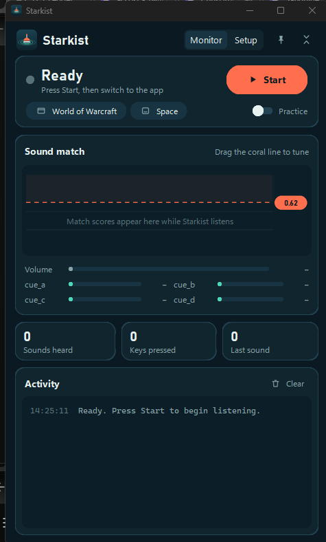
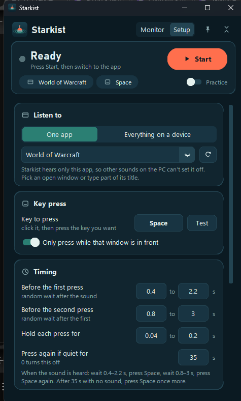
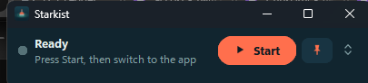

<div align="center">


# Starkist

**Listens for a sound cue, waits a random moment, then presses a key for you.**


</div>

Starkist listens to one application's audio for a reference sound. When it hears one, it waits a
random delay, presses a key, waits another random delay, and presses the key again.

<div align="center">
&nbsp;&nbsp;

</div>

## Start

Double-click **`run.bat`**. The first run sets everything up (about a minute); after that the
window opens straight away. If `uv` is not installed yet, `run.bat` offers to install it.

**`Create desktop shortcut.bat`** puts a Starkist icon on the desktop.

## Using the window

The bar at the top is always visible: what Starkist is doing, the app and key it is set to, and
the **Start / Stop** button. **Practice** listens and logs without pressing any key. The pin keeps
the window on top of other windows.

The chevrons next to the pin fold Starkist down to a one-line strip that stays on top so it can
sit in a corner of the screen — state, counts, Start / Stop, pin. The chevrons on the strip open
the full window again.

<div align="center">

</div>

### Setup

*(opens first on a new install)*

1. **Listen to** — pick the app from the list of open windows. "One app" hears only that app, so
   other sounds on the PC cannot set it off. "Everything on a device" hears a whole output device.
2. **Key press** — click the key button, then press the key you want. **Test** presses it after
   three seconds so you can check it lands in the app.
3. **Timing** — the random wait ranges. The sentence underneath spells out what will happen.
4. **Detection** — how close a match must be, and how long repeats are ignored.
5. **Sounds to listen for** — add `.wav` recordings or open the folder.

Changes save as you make them. If Starkist is listening, a bar offers **Restart to apply**.

### Monitor

- The trace shows the best match score over the last 40 seconds. The coral line is the trigger
  level: drag it up or down to tune it while you watch real scores. Coral ticks mark sounds that
  fired.
- Underneath: volume, the score of each sound, counts, and the activity log.

## Command line

```
uv run starkist --help
```

| command | what it does |
|---|---|
| `starkist gui` | open the window (same as `run.bat`) |
| `starkist run` | listen for the sound and send the key sequence |
| `starkist run --dry-run` | log matches without pressing anything |
| `starkist listen` | print audio level and per-sound match scores |
| `starkist devices` | list loopback devices for `capture.mode = "device"` |
| `starkist test-key` | press the configured key after a countdown |

Stop with Ctrl+C. Settings live in `config.toml`; the window and the command line share it.
With plain pip instead of uv: `pip install -e .` then `starkist gui`.

## Sounds

Every `.wav` in `assets/cues/` is a reference. The first 0.8 s of each is fingerprinted as a
gain-normalised log-mel spectrogram and matched by normalised cross-correlation against the live
stream.

## Notes

- Windows only. Capturing one app needs Windows 10 version 2004 or later.
- Presses are skipped when the chosen window is not in front (a switch in Setup turns that off).
- If the window fails to open, the reason is written to `starkist-error.log` in this folder.
- The logo and icons in `assets/ui/` are drawn by `tools/make_assets.py`.
